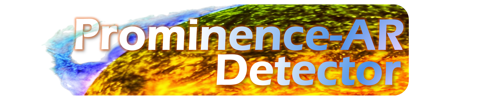
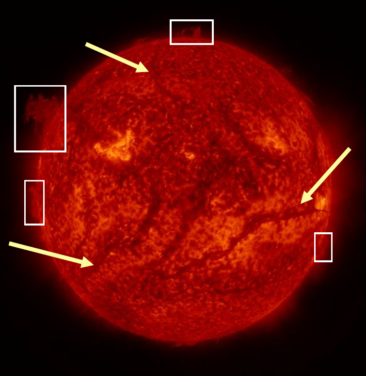

# Prominence-Detector
Object detection model for prominences (and additionally active regions) built using YOLOv11. The repository includes code to construct a prominences database from a given set of observations, along with statistical analysis of the physical properties of each prominence event.

The code is streamlined specifically for limb prominences (white boxes in the below images) taken in 304 &Aring channel observations from SDO/AIA, however, the model is capable of generalising to other instruments, provided the input images are preprocessed in the correct format. The code is not intended for on-disk filaments (yellow arrows in the image), as many other routines exist for the automatic detection of these objects. 



For a background in the motivation and development of an earlier version of the model, please refer to this [article](https://iopscience.iop.org/article/10.3847/1538-4357/ae664d). 
An additional article describing the current model, processing pipeline, and solar cycle results is currently in preperation, and will be linked here once completed.

The outline of the code is as follows:
1. Optional FITS data downloading via DRMS. This is specificall for SDO/AIA 304 &Aring, although other sources may be used.
2. Preprocessing data into our specific 3-channel format as depicted in the [article](https://iopscience.iop.org/article/10.3847/1538-4357/ae664d). This requires downloading the [WOW GitHub repo](https://github.com/frederic-auchere/wow), ensuring the path is added to the config run file.
3. Model Inferece on the preprocessed data. The model weights are hosted on [HuggingFace](https://huggingface.co/hbirch97/Prominence-AR_Detector/blob/main/README.md) and are automatically cached during this process.
4. Postprocessing the inference labels using the original FITS file to extract relevant parameters (positional, geometrical, intensity, and structural classification). Each label file will have a corresponding params.csv file with the parameter information.
5. Database compilation, outputting as a single csv file.
6. **(TBD)** Analysis of the results, following from that of the article (in prep). An .ipynb notebook document will be provided to faciliate this.

File tree:
```
[output_name]/
├── downloads/
│   └── *.fits
├── preprocessed_images/
│   └── *.jpg
├── inference_conf={conf}/
│   ├── labels/
│   │   └── *.txt
│   └── params/
│       └── *.csv
├── database.csv
└── analysis.ipynb
```
